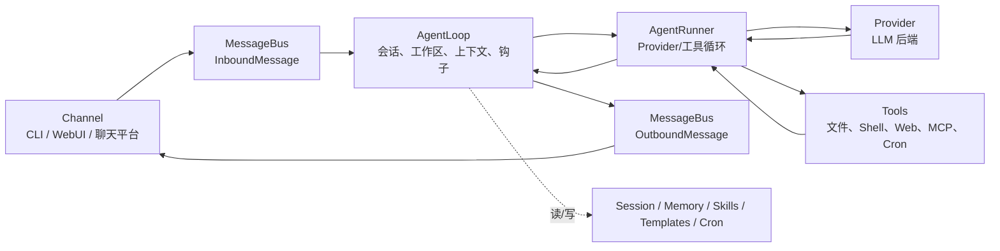

# 系统架构

## 总体分层

该图与 `docs/architecture.md:7-23` 一致；代码侧入口为 `nanobot/bus/events.py:29-56`（消息结构）与 `nanobot/agent/loop.py`、`nanobot/agent/runner.py`。

## 核心运行链路

1. 通道接收平台事件，构造 `InboundMessage` 并通过 `MessageBus.publish_inbound` 入队（`nanobot/channels/base.py:327-406`、`nanobot/bus/queue.py`）。
2. `AgentLoop` 消费入站消息，解析会话键、工作区作用域、模型运行时与上下文，再调用 `AgentRunner`（`nanobot/agent/loop.py:1383-1394` 起）。
3. `AgentRunner` 选择 Provider，处理流式增量/推理块，执行工具调用并把结果回填给模型，直到产出最终答复或触发迭代上限（`nanobot/agent/runner.py`、`docs/architecture.md:36-58`）。
4. `AgentLoop` 将 `OutboundMessage` 发布到总线，`ChannelManager` 的出站分发循环按通道发送，含重试与 outbox（`nanobot/channels/manager.py:902-1005`）。

## 关键文件

| 领域 | 文件 |
| --- | --- |
| 消息事件与队列 | `nanobot/bus/events.py`、`nanobot/bus/queue.py`、`nanobot/bus/runtime_events.py` |
| 轮次编排 | `nanobot/agent/loop.py` |
| Provider/工具循环 | `nanobot/agent/runner.py` |
| 上下文构建与治理 | `nanobot/agent/context.py`、`nanobot/agent/context_governance.py` |
| 会话状态与存储 | `nanobot/session/state.py`、`nanobot/session/sqlite_store.py`、`nanobot/session/manager.py` |
| 长期记忆与 Dream | `nanobot/agent/memory.py`、`nanobot/agent/dream.py` |
| 通道发现与生命周期 | `nanobot/channels/registry.py`、`nanobot/channels/manager.py` |
| Provider 注册与选择 | `nanobot/providers/registry.py`、`nanobot/providers/routing.py`、`nanobot/providers/factory.py` |
| 工具注册与加载 | `nanobot/agent/tools/registry.py`、`nanobot/agent/tools/loader.py` |
| 网关启动 | `nanobot/cli/gateway_runtime.py`、`nanobot/cli/gateway.py` |
| 进程内 SDK 门面 | `nanobot/nanobot.py` |

## AgentLoop 与 AgentRunner 的职责边界

- `AgentLoop` 拥有“面向通道的一轮”：接收消息、确定有效会话与工作区、构建上下文、装配钩子/进度/通道元数据、发布出站消息（`docs/architecture.md:38-45`）。
- `AgentRunner` 拥有“面向模型的循环”：调用 Provider、流式增量与推理块、执行工具、回填工具结果、在最终答复或运行时上限处停止（`docs/architecture.md:46-52`）。
- 排障时：通道路由、会话键、工作区选择、出站投递问题从 `loop.py` 入手；Provider 调用、工具调用、流式、迭代上限问题从 `runner.py` 入手（`docs/architecture.md:56`）。

## 组合根与外部资源所有权

- MCP 连接是应用级基础设施：组合根创建 `MCPProvider`，把它的 `ToolRegistry` 共享给 `AgentLoop`，使用前 `connect()`，关闭时 `aclose()`；`AgentLoop.from_config()` 要求调用方持有 `ToolRegistry`（`docs/architecture.md:54`）。
- 进程内 SDK 组合根：`Nanobot.from_config()` 加载配置、创建 `ToolRegistry`、注册图像生成工具、构造 `MCPProvider`，再调用 `AgentLoop.from_config()`（`nanobot/nanobot.py:90-142`）。
- 网关组合根：`_run_gateway` 依次构建 `MessageBus`、Provider 快照、`SessionManager`、`CronService`、`ToolRegistry` + `MCPProvider`、`AgentLoop`、`ChannelManager`，随后启动 cron、Agent 循环、通道、本地触发器、配置监听与健康服务（`nanobot/cli/gateway_runtime.py:505-588,738-759,939-1010`）。

## 网关启动序列（`nanobot gateway`）

1. 解析端口（`config.gateway.port`，默认 18790）并获取网关实例锁（`nanobot/cli/gateway_runtime.py:383-429`）。
2. 装配总线、Provider、会话管理、Cron（`<workspace>/cron/jobs.json`）、工具与 MCP（`nanobot/cli/gateway_runtime.py:505-562`）。
3. 构造 `AgentLoop` 与 `ChannelManager`；WebSocket 通道获得 WebUI 网关服务（`nanobot/cli/gateway_runtime.py:571-588,738-759`）。
4. 注册系统 cron 任务 Dream 与 heartbeat（`nanobot/cli/gateway_runtime.py:837-865`）。
5. 启动健康端点 `GET /health`（200/503 JSON，含 `runtime` 身份与 `maintenance` 标记）（`nanobot/cli/gateway_runtime.py:780-836`）。
6. 启动已启用通道与出站分发、本地触发器、配置监听（`nanobot/cli/gateway_runtime.py:939-983`）。

## 事件与状态传播

- `MessageBus.publish` 会等待本地订阅者处理 turn/run/model/goal 状态变化；`publish_event` 只把路由后的通道投递排队，不等待网络发送（`.agent/design.md:9`）。
- Runner 钩子通过本轮作用域的 `EventSink` 发布类型化输出；直接回调在执执行边界适配（`.agent/design.md:9`）。
- WebUI/WebSocket 线协议投影由 `nanobot/webui/outbound_delivery.py` 负责；WebSocket 传输只负责快照接收者、排队公共帧、连接顺序与背压（`.agent/design.md:9`）。

## 上下文预算与压缩

- 文件读取导致请求超预算时，Runner 先总结模型已接收的历史；仍放不下时，只把必要的未读文本结果替换为“请读取更小范围”的预算错误，并保存该错误用于重放（`docs/architecture.md:60-62`）。
- 空闲会话自动压缩由 `AgentDefaults.session_ttl_minutes`（别名 `idleCompactAfterMinutes`）控制（`nanobot/config/schema.py:210-219`）；压缩治理在 `nanobot/agent/autocompact.py`、`nanobot/agent/context_governance.py`。

## 并发与一致性

- 会话写入由 `SessionState` 串行化：每键 FIFO 队列 + 单写执行器 + 读线程池；`save` 比较 `(revision, generation)`，冲突抛 `SessionConflictError`（`nanobot/session/state.py:40-93`、`nanobot/session/sqlite_store.py:420-437`）。
- 删除以 tombstone 记录，避免并发恢复；fork 在一个 SQLite 事务内复制前缀（`nanobot/session/state.py:1019-1102`、`nanobot/session/sqlite_store.py:726-749`）。

## 设计约束（对架构变更生效）

- 核心保持小：新能力优先放在 `channels/`、工具、技能或 MCP 中，`agent/loop.py` 与 `agent/runner.py` 的改动应最小且有理由（`.agent/design.md:5-7`）。
- 可执行的导入边界：核心执行、会话存储、安全原语不得依赖 API/通道/CLI/WebUI 适配器；由 `scripts/check_import_boundaries.py` 与 `scripts/check_client_import_boundaries.mjs` 检查（`.agent/design.md:15-21`）。
- 优先重复而非过早抽象；通道与 Provider 允许各自重复重试/媒体/分片逻辑（`.agent/design.md:27-29`）。
- 动态边界在边缘解析：线协议负载、持久化记录、第三方 SDK 对象在所属边缘校验，内部使用具体类型（`.agent/design.md:31-37`）。
- 显式优于魔法：Provider 自动检测必须可从工厂追溯到具体类（`.agent/design.md:39-41`）。

## 安全边界总览

| 边界 | 文件 |
| --- | --- |
| 工作区作用域 | `nanobot/security/workspace_access.py`、`nanobot/security/workspace_policy.py`、`nanobot/execution/files.py` |
| Shell 沙箱 | `nanobot/agent/tools/shell.py`、`nanobot/execution/sandbox.py`、`nanobot/security/sandbox_launcher.py` |
| SSRF/网络策略 | `nanobot/security/network.py`、`nanobot/agent/tools/web.py` |
| 通道访问控制 | 各通道配置中的 pairing / `allowFrom` 等 |

细节见 `project/modules/security.md` 与 `.agent/security.md`。

## 扩展点

| 扩展 | 方式 | 出处 |
| --- | --- | --- |
| Provider | 在 `providers/registry.py` 增加 `ProviderSpec` + `config/schema.py` 字段；通用后端够用时不写新实现 | `docs/architecture.md:217-227` |
| 通道 | 一个自包含包，导出 `ChannelPlugin` 描述符 | `docs/channel-package-guide.md`、`nanobot/channels/plugin.py` |
| 工具 | 在 `agent/tools/` 实现 `Tool` 子类，或提供 `nanobot.tools` entry point | `nanobot/agent/tools/loader.py:18-87` |
| MCP | 配置 `tools.mcpServers`，或在 Agent Plugin 中内置 | `nanobot/config/schema.py:411-424` |
| 技能 | 工作区 `skills/`、Agent Plugin 或内置 `nanobot/skills/` | `nanobot/agent/skills.py` |
| CLI App | CLI Apps 目录 + 安装器管理可执行文件，写入 skills-only Agent Plugin | `docs/architecture.md:225` |

## 测试与验证

- Python：`pytest`（`testpaths = ["tests", "nanobot/channels"]`，覆盖率下限 75%）、`ruff check nanobot/`、`basedpyright`（strict）。
- WebUI：`cd webui && bun run test`、`bun run build`、`bun run test:browser`。
- TUI：`cd tui && bun test`。
- 导入边界：`python -m scripts.check_import_boundaries`、`bun run check:imports`。
- CI 按受影响契约选择检查（`scripts/ci_scope.py`、`.github/workflows/ci.yml`）。

## 待人工确认的疑点

1. `docs/architecture.md` 提到 WebUI 由 WebSocket 通道提供，但历史文档/旧安装可能仍引用已移除的 `nanobot serve`（`nanobot/cli/commands.py:137-151`）；对外文档需统一口径。
2. 网关健康端点的 `runtime` 身份字段用于本机就绪判断，跨版本组合无兼容保证（`AGENTS.md`），部署侧需确认版本对齐策略。

## 来源

- `docs/architecture.md`、`docs/concepts.md`、`.agent/design.md`、`.agent/security.md`
- `nanobot/bus/events.py:29-56`
- `nanobot/agent/loop.py`、`nanobot/agent/runner.py`
- `nanobot/channels/base.py:327-406`、`nanobot/channels/manager.py:902-1005`
- `nanobot/nanobot.py:90-142`
- `nanobot/cli/gateway_runtime.py:383-429,505-588,738-865,939-1010`
- `nanobot/config/schema.py:177-247,402-408,411-424`
- `nanobot/session/state.py:40-93,1019-1102`、`nanobot/session/sqlite_store.py:420-437,726-749`
- `nanobot/agent/tools/loader.py:18-87`
- `AGENTS.md`
